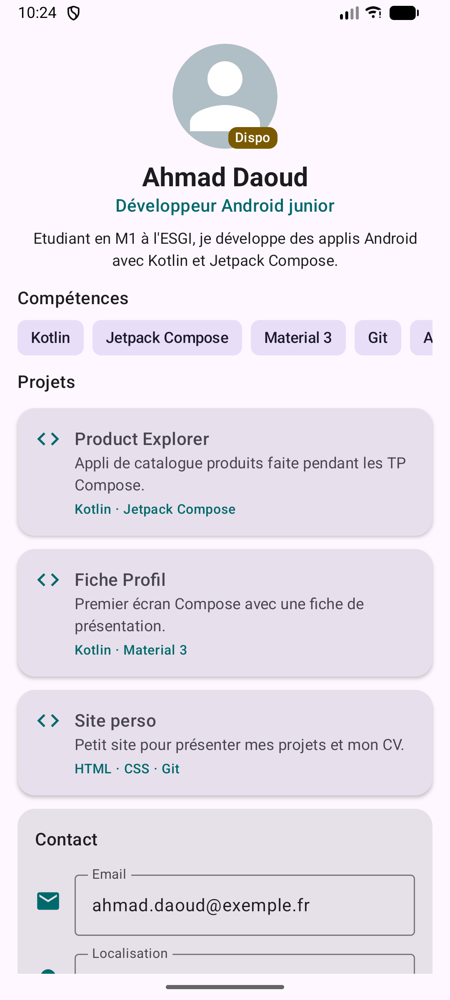
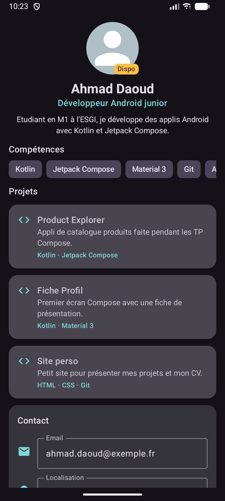
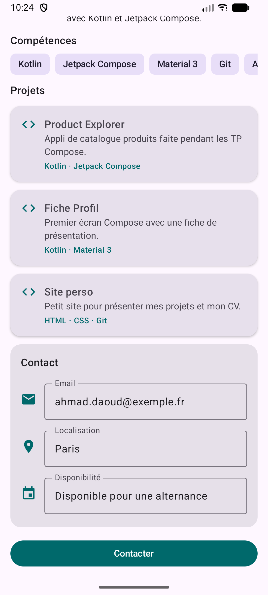
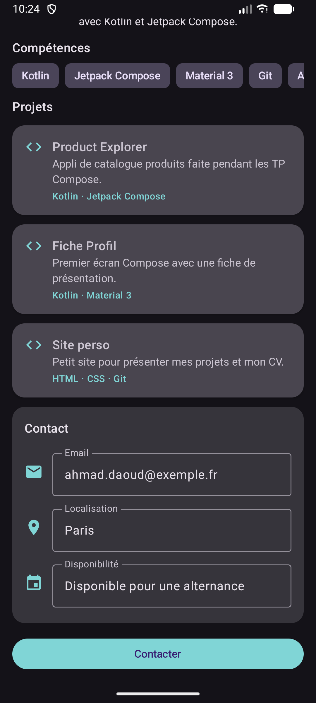

# Profil Développeur – Amélioration UI (Jetpack Compose)

Deuxième version de mon appli « Profil développeur » pour le cours Jetpack Compose à l'ESGI.
L'appli affiche mon profil sur un seul écran : avatar avec un badge « Dispo », nom, rôle, une courte description, mes compétences, mes projets, une carte contact et un bouton « Contacter ».
Toutes les données sont écrites en dur dans le code Kotlin, il n'y a pas d'API. Le bouton appelle juste un callback vide.

## Captures d'écran

| Clair | Sombre |
|-------|--------|
|  |  |
|  |  |

## Composants Compose utilisés
- `Text` : nom, rôle, description, titres des sections, infos des projets
- `Button` : le bouton « Contacter »
- `Icon` : icône des projets et des lignes de contact (email, localisation, dispo)
- `Image` : l'avatar (un drawable placeholder)
- `Card` : les cartes projets et la carte contact
- `OutlinedTextField` en `readOnly = true` : email, localisation et disponibilité
- `Scaffold` : la base de l'écran

## Layouts utilisés
- `Column` : pour empiler les éléments (header, contenu des cartes)
- `Row` : icône + texte dans les cartes projets et les lignes de contact
- `Box` : l'avatar avec le badge « Dispo » posé par-dessus en bas à droite
- `Spacer` : pour les espaces entre les éléments
- `Surface` : le badge « Dispo » et les pastilles de compétences, avec les couleurs et les formes du thème

## Les listes (LazyColumn et LazyRow)
Tout l'écran est une `LazyColumn` :
- un `item { }` pour le header (avatar, nom, rôle, description) ;
- un `item { }` pour les compétences, affichées dans une `LazyRow` horizontale avec un `SkillChip` par compétence ;
- `items(projects, key = { it.id })` pour les projets, chaque projet est affiché avec une `ProjectCard` ;
- un `item { }` pour la `ContactCard` et le bouton.

Les projets viennent d'une `data class Project` et de la fonction `sampleProjects()`. L'`id` sert de clé pour la liste.
Comme l'écran est déjà une `LazyColumn`, il n'y a pas de liste dans une `Column` qui scrolle.

## Choix du thème
- Palette perso avec 3 couleurs : bleu canard en `primary` (rôle, icônes, bouton), indigo en `secondary` et ambre en `tertiary` (le badge « Dispo »).
- Une version claire et une version sombre (couleurs plus claires pour rester lisibles sur fond noir). Le thème suit le réglage du téléphone avec `isSystemInDarkTheme()`.
- Les couleurs dynamiques (`dynamicColor`) sont désactivées pour garder ma palette.
- `typography` : j'ai juste mis le nom en gras (`headlineSmall`), le reste utilise les styles de base de Material 3.
- `shapes` : coins arrondis de 8 dp (`small`) pour les pastilles et le badge, 16 dp (`medium`) pour les cartes.

## Previews
- « Junior Android - clair » et « Junior Android - sombre » (avec `uiMode = Configuration.UI_MODE_NIGHT_YES`)
- « Full-stack pas dispo » : un autre profil avec d'autres compétences et projets, sans le badge

## Quelles notions du chapitre Compose UI avez-vous réutilisées dans cette application ?
J'ai réutilisé les composants de base (`Text`, `Button`, `Icon`, `Image`, `Card`, `OutlinedTextField` en lecture seule), les layouts (`Column`, `Row`, `Box`, `Spacer`, `Surface`), les listes modernes avec `LazyColumn` et `LazyRow` (avec `item`, `items` et une `key`), et des composables réutilisables pour chaque élément de liste (`SkillChip`, `ProjectCard`, `ContactInfo`).
Côté Material 3, j'utilise `MaterialTheme.colorScheme`, `typography` et `shapes` partout au lieu de valeurs en dur, avec un thème clair et un thème sombre.
J'ai aussi gardé les bonnes pratiques du premier devoir : petits composables, `modifier` en paramètre, callbacks pour les actions, `contentDescription` sur les images et icônes, et plusieurs previews.
